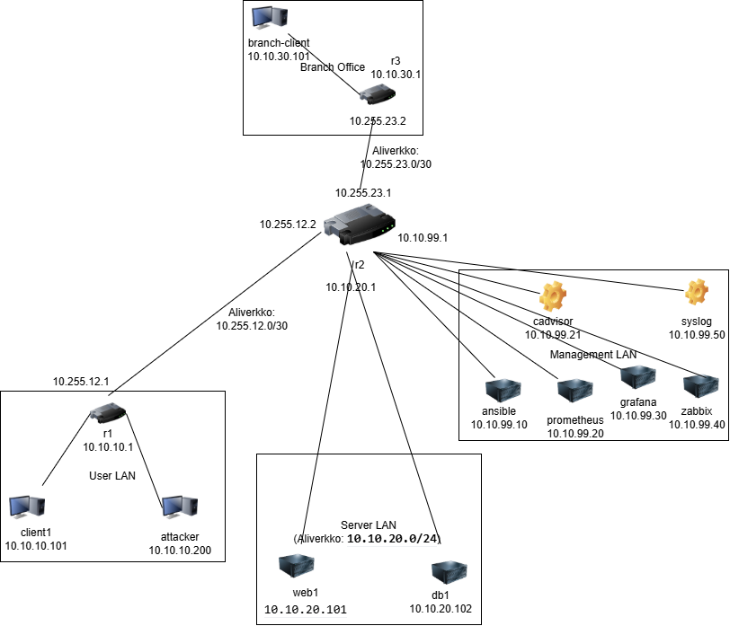

# Viikko 1 – Verkon dokumentointi

## 1. Johdanto
Tämän dokumentaation tarkoituksena on kartoittaa ja kuvata kurssin virtuaalinen verkkoympäristö (Golden Clab). Ajantasainen ja tarkka verkkodokumentaatio on verkonhallinnan perusvaatimus, joka mahdollistaa tehokkaan verkon ylläpidon, vianetsinnän, muutostenhallinnan sekä tietoturvan arvioinnin. Tämä dokumentti toimii pohjana tuleville harjoituksille.

## 2. Verkkokaavio
Verkon looginen ja fyysinen rakenne perustuu kolmeen reitittimeen, jotka yhdistävät käyttäjä-, palvelin- ja etätoimistoalueet (Branch Office) sekä erillisen hallintaverkon (Management LAN).



## 3. Laiteluettelo
Ympäristö koostuu reitittimistä, asiakaslaitteista, palvelimista sekä valvonta- ja hallintatyökaluista.

| Laite | Tarkoitus | Lyhyt kuvaus |
| :--- | :--- | :--- |
| **r1** | Reititin (Router 1) | Reitittää liikennettä User LAN -verkon (10.10.10.0/24) ja runkoverkon välillä. Toimii User LANin yhdyskäytävänä. |
| **r2** | Keskusreititin (Router 2) | Verkon solmukohta, joka yhdistää Server LAN-, Management LAN- ja runkoyhteydet r1:een ja r3:een. |
| **r3** | Etätoimiston reititin (Router 3) | Reitittää Branch Office -verkon (10.10.30.0/24) liikennettä kohti keskusverkkoa r2:n kautta. |
| **client1** | Asiakaskone (User) | Normaali käyttäjälaite User LAN -verkossa. Käytetään tässä dokumentissa yhteyksien ja reitityksen testaamiseen. |
| **attacker** | Testauslaite (Attacker) | Tietoturva- ja hyökkäystestausta varten sijoitettu Kali Linux -laite User LAN -verkossa. |
| **web1** | Web-palvelin | Server LAN -verkossa sijaitseva Ubuntu-pohjainen sovellus- tai verkkopalvelin. |
| **db1** | Tietokantapalvelin | Server LAN -verkossa sijaitseva tietokantapalvelin, joka palvelee web-palvelinta. |
| **branch-client** | Etätoimiston asiakaskone | Etätoimipisteen (Branch Office) lähiverkossa sijaitseva asiakaslaite. |
| **ansible** | Hallintapalvelin | Automaatio- ja konfiguraationhallintatyökalu laitteiden keskitettyyn hallintaan Management LAN -verkossa. |
| **prometheus** | Metriikkapalvelin | Kerää aikasarjadataa ja metriikoita verkon laitteista ja palveluista. |
| **grafana** | Visualisointipalvelu | Prometheuksen keräämän datan visualisointi ja valvontakojelautojen näyttäminen. |
| **zabbix** | Valvontajärjestelmä | Verkon ja infrastruktuurin kattava tilanvalvonta, hälytykset ja raportointi. |

## 4. IP-suunnitelma
Ympäristön IP-osoiteavaruus on jaettu loogisiin aliverkkoihin käyttötarpeen mukaan.

| Verkko | Tarkoitus / Kuvaus | Yhdyskäytävä | Kuuluvat laitteet |
| :--- | :--- | :--- | :--- |
| **10.10.10.0/24** | User LAN – Tavallisten käyttäjien päätelaitteet | 10.10.10.1 (r1) | `client1` (10.10.10.101), `attacker` (10.10.10.200) |
| **10.10.20.0/24** | Server LAN – Tuotantopalvelimien eristetty verkko | 10.10.20.1 (r2) | `web1` (10.10.20.101), `db1` (10.10.20.102) |
| **10.10.30.0/24** | Branch Office – Etätoimipisteen asiakasverkko | 10.10.30.1 (r3) | `branch-client` (10.10.30.101) |
| **10.10.99.0/24** | Management LAN – Hallinta- ja valvonta-alusta | 10.10.99.1 (r2) | `ansible`, `prometheus`, `grafana`, `zabbix` |
| **10.255.12.0/30** | Runkoyhteys (Point-to-Point) – Reitittimien välinen linkki | - | Reitittimet `r1` (10.255.12.1) ja `r2` (10.255.12.2) |
| **10.255.23.0/30** | Runkoyhteys (Point-to-Point) – Reitittimien välinen linkki | - | Reitittimet `r2` (10.255.23.1) ja `r3` (10.255.23.2) |

## 5. Reitityksen analyysi
Yhteyksiä ja reititystä tutkittiin `client1`-laitteelta käsin. Tehtyjen mittausten perusteella yhteys on kunnossa kaikkiin verkkoihin.

### 5.1 Osoitteet ja reititystaulu (`client1`)
Komentojen `ip addr` ja `ip route` tulosteet kontista:

```text
root@client1:/# ip addr
1: lo: <LOOPBACK,UP,LOWER_UP> mtu 65536 qdisc noqueue state UNKNOWN group default qlen 1000
    link/loopback 00:00:00:00:00:00 brd 00:00:00:00:00:00
    inet 127.0.0.1/8 scope host lo
       valid_lft forever preferred_lft forever
    inet6 ::1/128 scope host
       valid_lft forever preferred_lft forever
88: eth0@if89: <BROADCAST,MULTICAST,UP,LOWER_UP> mtu 1500 qdisc noqueue state UP group default
    link/ether 02:42:ac:14:14:0f brd ff:ff:ff:ff:ff:ff link-netnsid 0
    inet 172.20.20.15/24 brd 172.20.20.255 scope global eth0
       valid_lft forever preferred_lft forever
    inet6 fe80::42:acff:fe14:140f/64 scope link
       valid_lft forever preferred_lft forever
111: eth1@if110: <BROADCAST,MULTICAST,UP,LOWER_UP> mtu 9500 qdisc noqueue state UP group default
    link/ether aa:c1:ab:52:78:48 brd ff:ff:ff:ff:ff:ff link-netnsid 1
    altname clab-o-05031180f95d8850
    inet 10.10.10.101/24 scope global eth1
       valid_lft forever preferred_lft forever
    inet6 fe80::a8c1:abff:fe52:7848/64 scope link
       valid_lft forever preferred_lft forever
```

```text
root@client1:/# ip route
default via 10.10.10.1 dev eth1
10.10.10.0/24 dev eth1 proto kernel scope link src 10.10.10.101
172.20.20.0/24 dev eth0 proto kernel scope link src 172.20.20.15
```
*Analyysi:* Laitteen `client1` IP-osoite tuotantoverkossa on `10.10.10.101` rajapinnassa `eth1`. Sen oletusyhdyskäytävänä (default gateway) toimii reititin `r1` osoitteessa `10.10.10.1`. Rajapinta `eth0` (`172.20.20.15`) on Containerlabin sisäinen hallintayhteys.

### 5.2 Yhteystestit (Ping)
Yhteydet testattiin onnistuneesti Server LAN- ja Branch Office -verkkoihin ilman pakettihävikkiä (0% packet loss):

* **Ping web1-palvelimeen (`10.10.20.101`):**
```text
root@client1:/# ping -c 4 10.10.20.101
PING 10.10.20.101 (10.10.20.101) 56(84) bytes of data.
64 bytes from 10.10.20.101: icmp_seq=1 ttl=62 time=1.64 ms
64 bytes from 10.10.20.101: icmp_seq=2 ttl=62 time=0.061 ms
64 bytes from 10.10.20.101: icmp_seq=3 ttl=62 time=0.058 ms
64 bytes from 10.10.20.101: icmp_seq=4 ttl=62 time=0.082 ms

--- 10.10.20.101 ping statistics ---
4 packets transmitted, 4 received, 0% packet loss, time 3069ms
rtt min/avg/max/mdev = 0.058/0.461/1.643/0.682 ms
```

* **Ping branch-clientiin (`10.10.30.101`):**
```text
root@client1:/# ping -c 4 10.10.30.101
PING 10.10.30.101 (10.10.30.101) 56(84) bytes of data.
64 bytes from 10.10.30.101: icmp_seq=1 ttl=61 time=2.37 ms
64 bytes from 10.10.30.101: icmp_seq=2 ttl=61 time=0.057 ms
64 bytes from 10.10.30.101: icmp_seq=3 ttl=61 time=0.058 ms
64 bytes from 10.10.30.101: icmp_seq=4 ttl=61 time=0.071 ms

--- 10.10.30.101 ping statistics ---
4 packets transmitted, 4 received, 0% packet loss, time 3077ms
rtt min/avg/max/mdev = 0.057/0.639/2.373/1.000 ms
```
*Analyysi:* 
* **100 % toimivuus:** Pakettihävikkiä ei esiintynyt (0% packet loss), mikä osoittaa verkkoyhteyksien ja reitityksen olevan täysin kunnossa kaikkien segmenttien välillä.
* **Erittäin pieni viive:** Keskimääräinen vasteaika oli alle millisekunnin (Server LAN: 0.46 ms, Branch Office: 0.63 ms). Tämä kertoo tehokkaasta ja ruuhkattomasta reitityksestä konttien välillä.
* **ARP-viive alussa:** Ensimmäisen paketin hieman pidempi vasteaika (1.6–2.3 ms) johtuu verkon normaalista osoitteenselvityksestä (ARP-haku), jonka jälkeen viive tasaantui nollan tuntumaan.
* **Korkea vakaus:** Viiveen vaihtelu (mdev) oli olematonta, mikä tarkoittaa erittäin vakaata ja jitter-vapaata yhteyttä.

### 5.3 Reitin seuranta (Traceroute)
Paketin kulkua seurattiin `branch-client`-laitteelle:
```text
root@client1:/# traceroute 10.10.30.101
traceroute to 10.10.30.101 (10.10.30.101), 30 hops max, 60 byte packets
 1  10.10.10.1 (10.10.10.1)  1.790 ms  1.601 ms  1.566 ms
 2  10.255.12.2 (10.255.12.2)  1.504 ms  1.253 ms  1.228 ms
 3  10.255.23.2 (10.255.23.2)  1.089 ms  0.922 ms  0.836 ms
 4  10.10.30.101 (10.10.30.101)  0.787 ms  0.703 ms  0.547 ms
```

*Reittianalyysi:*
Paketti kulkee onnistuneesti maaliin seuraavien reitittimien (hyppyjen) kautta:
1. **Hyppy 1 (`10.10.10.1`):** Reititin `r1` (User LAN oletusyhdyskäytävä).
2. **Hyppy 2 (`10.255.12.2`):** Keskusreititin `r2` (Runkolinkki r1 -> r2).
3. **Hyppy 3 (`10.255.23.2`):** Etätoimiston reititin `r3` (Runkolinkki r2 -> r3).
4. **Hyppy 4 (`10.10.30.101`):** Kohdelaite `branch-client`.

Liikenne kulkee loogisesti reitittimien **r1 -> r2 -> r3** läpi. Kaikki verkkosegmentit ovat saavutettavissa.

## 6. Yhteenveto

### Pohdinta 1: Mitkä asiat verkon dokumentaation muodostamisessa kuluttivat eniten aikaa ja miksi?
Eniten aikaa vei laboratorion käynnistymiseen liittyvän Docker/Containerlab-virhetilanteen selvittäminen. Aiemmasta istunnosta taustalle jääneet verkkorajapinnat (haamutilat) estivät Containerlabia luomasta uusia siltoja, mikä johti kriittiseen virheeseen: `Node "srv-br|srv-bp": cannot exec a command, container network namespace is not available (status=NotFound)`.

Ongelma saatiin ratkaistua nollaamalla ympäristön tila kokonaan virtuaalikoneen komentoriviltä suorittamalla laaja Docker-puhdistus:
1. Pysäytettiin ja tuhottiin haamukontit: `sudo containerlab destroy --all`
2. Siivottiin Dockerin käyttämättömät verkot ja resurssit: `sudo docker network prune -f` ja `sudo docker system prune -f`
3. Käynnistettiin Docker-palvelu kokonaan uudelleen: `sudo systemctl restart docker`
Tämän puhdistuksen jälkeen verkkoympäristö pystytettiin onnistuneesti komennolla `sudo bash scripts/deploy.sh`. Tämän jälkeen itse komentojen ajaminen ja topologian hahmottaminen oli suoraviivaista. Verkkokaavion piirtämisessä draw.io-ohjelmalla aikaa kului reitittimien välisten Point-to-Point /30-runkoverkkojen ja yhdyskäytävien tarkassa hahmottamisessa porttitasolla.

### Pohdinta 2: Miten dokumentaatio mielestäsi auttaa palvelusta vastaavaa it-asiantuntijaa työssään?
Laadukas ja ajantasainen verkkodokumentaatio on asiantuntijan tärkein työkalu arjessa. Se nopeuttaa vianetsintää (Troubleshooting), sillä katkotilanteessa reitit, IP-osoitteet ja yhdyskäytävät voidaan tarkistaa sekunneissa suoraan loogisesta kaaviosta ilman tarvetta kirjautua manuaalisesti jokaiselle reitittimelle erikseen. Esimerkiksi vikatilanteessa asiantuntija näkee heti kaaviosta, minkä reitittimen takana laite on ja mitä reittiä liikenteen tulisi kulkea, jos palvelimessa olisi ongelmaa. Tämä säästää kriittistä aikaa ja lyhentää katkoaikoja. 

Dokumentaatio tuo myös varmuutta muutostilanteisiin (kapasiteettisuunnittelu ja laajennukset), sillä IP-suunnitelmasta nähdään heti vapaat osoiteavaruudet ja oikeat hallintaverkot (Management LAN), mikä estää osoitekonfliktien syntymisen ja konfiguraatiovirheet, jos verkkoon lisätään uusia laitteita tai palveluita. Lisäksi se suoraviivaistaa uusien työntekijöiden perehdytystä ja helpottaa tietoturva-auditointeja, kun verkon segmentointi ja rajapinnat (kuten Server LANin eristys oikeaoppisesti käyttäjäverkoista) on kuvattu selkeästi.