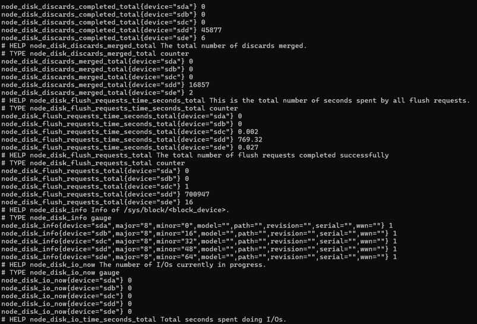
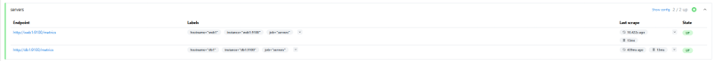
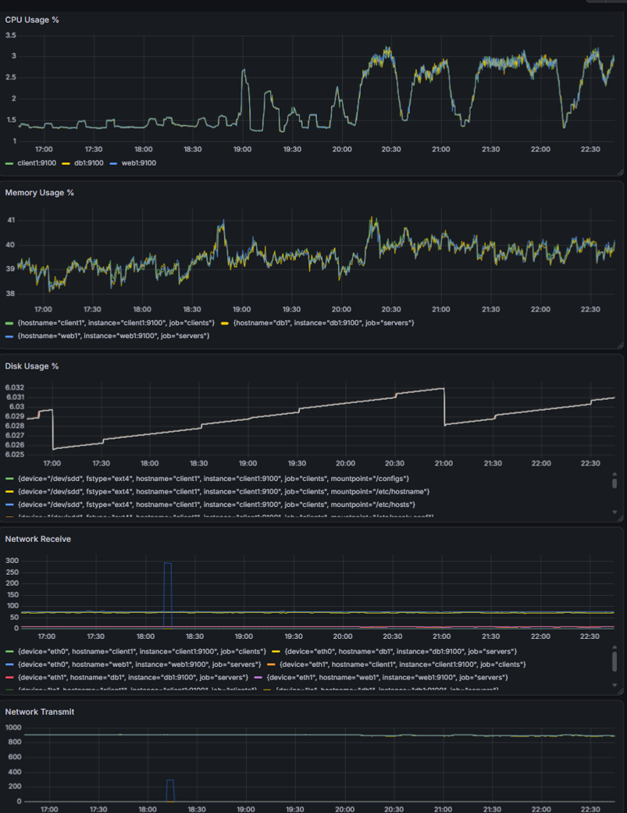
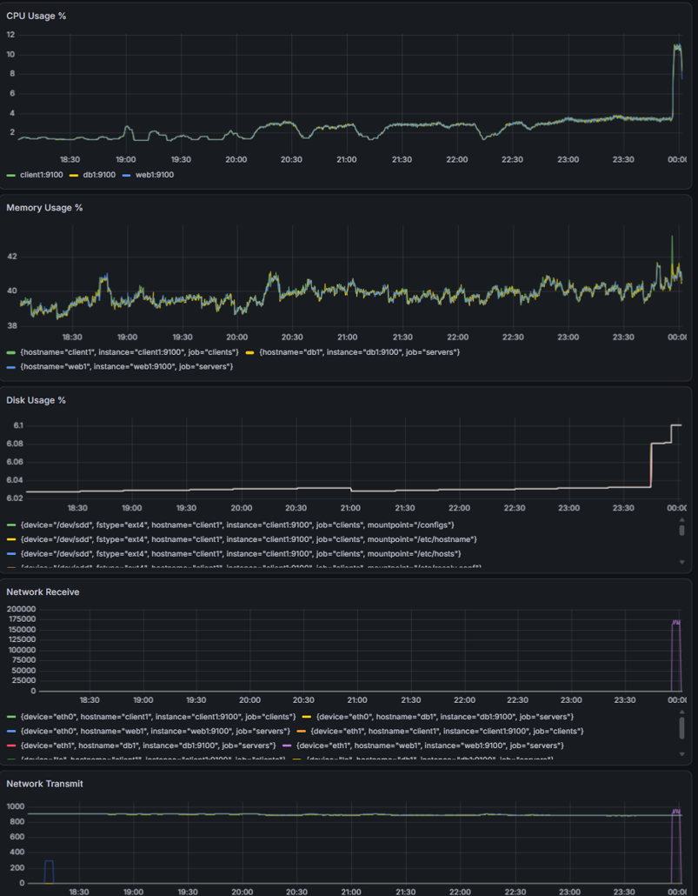

# Viikko 3 – Prometheus, Node Exporter ja Grafana

## 1. Johdanto

### Mitä monitorointi tarkoittaa?
Monitorointi tarkoittaa tietojärjestelmien, palveluiden, sovellusten ja verkkoinfrastruktuurin tilan, suorituskyvyn sekä toiminnan jatkuvaa ja automaattista seurantaa. Se perustuu numeeristen metriikoiden (kuten resurssien käyttöasteet), lokitietojen ja tapahtumien säännölliseen keräämiseen ja analysointiin.

### Miksi monitorointi on tärkeää palveluiden ja verkkojen ylläpidossa?
Monitorointi on proaktiivisen ylläpidon ja häiriönhallinnan kulmakivi. Sen avulla IT-asiantuntijat voivat:
* **Havaita viat ennen loppukäyttäjiä:** Automatisoidut hälytykset ilmoittavat ongelmista (esim. kriittisen palvelun sammumisesta) välittömästi.
* **Kapasiteettisuunnitteluun:** Pitkän aikavälin trendeistä nähdään, milloin esimerkiksi levytila on loppumassa tai palvelinkapasiteettia on laajennettava.
* **Nopeampaan vianetsintään:** Historiadatan avulla voidaan analysoida, mikä aiheutti järjestelmän kaatumisen tai hidastumisen tiettynä ajanhetkenä.

### Mikä on Prometheus-monitoroinnin toimintaperiaate?
Prometheus on avoimen lähdekoodin moderni monitorointi- ja hälytysjärjestelmä, joka on suunniteltu erityisesti pilvitorviorientoituneisiin dynaamisiin ympäristöihin. Toisin kuin perinteiset järjestelmät, Prometheus perustuu **pull-malliin**, eli se hakee (scrape) metriikat säännöllisesti valvottavien laitteiden päätepisteistä (endpoints) HTTP-protokollan yli ja tallentaa ne tehokkaaseen aikasarjatietokantaan (TSDB).

---

## 2. Node Exporterin käyttöönotto
Node Exporter toimii agenttina, joka kerää Linux-isäntäkoneen suorituskykymetriikat (kuten CPU, muisti ja levy) ja asettaa ne tarjolle HTTP-porttiin 9100.

### Asennusvaiheet web1-koneella:
Kirjauduttiin `web1`-konttiin ja asennettiin tarvittavat lataustyökalut:
```bash
docker exec -it clab-hamk-verkonhallinta-golden-web1 bash
apt update && apt install wget tar -y
```

Ladattiin uusin vakaa versio (1.12.1) GitHubista, purettiin paketti ja käynnistettiin palvelu taustalle pyörimään:
```bash
wget https://github.com
tar xvf node_exporter-1.12.1.linux-amd64.tar.gz
cd node_exporter-1.12.1.linux-amd64
./node_exporter &
```

### Toiminnan testaus ansible-kontista:
Varmistettiin cURL-työkalulla, että agentti palauttaa raakametriikoita verkon yli:
```bash
curl http://web1:9100/metrics
```



**Esimerkki saaduista mittaririveistä:**
```text
go_gc_duration_seconds{quantile="0"} 2.3673e-05
go_goroutines 8
node_boot_time_seconds 1.792932766e+09
node_cpu_seconds_total{cpu="0",mode="idle"} 96424.96
```

---

## 3. Prometheus Targets
Selaimessa avattiin osoite `http://localhost:9090` ja navigoitiin sivulle **Status → Targets**.



*Havainnot:* `web1:9100` ja `db1:9100` näkyvät listalla onnistuneesti vihreässä tilassa **UP**. Tämä vahvistaa, että Prometheuksen keskuspalvelin on saanut yhteyden Node Exportereihin ja kerää dataa määritellyn 15 sekunnin välein ilman verkko- tai palomuuriongelmia.

---

## 4. Grafanan tietolähde
Grafanassa (`http://localhost:3000`) kytkettiin Prometheus-tietolähde lisäämällä osoitteeksi ympräristön sisäinen URL `http://prometheus:9090`.


*Havainnot:* Yhteystesti meni puhtaasti läpi ja antoi vihreän vahvistuksen *Successfully queried the Prometheus API*, mikä varmistaa että visualisointialustalla on suora yhteys aikasarjatietokantaan.

---

## 5. Dashboard (Perustila)
Ympäristöön luotiin uusi koontinäkymä nimellä **Golden Topology Monitoring**, johon rakennettiin 5 vaadittua paneelia käyttäen PromQL-kyselykieltä (`Code`-tilassa).



### Rakennetut paneelit ja PromQL-kaavat:
1. **CPU Usage %** (Time series): `100 - (avg by(instance) (rate(node_cpu_seconds_total{mode="idle"}[5m])) * 100)`
   * *Mitä mittaa:* Laskee järjestelmän todellisen CPU-kuorman vähentämällä joutokäynnin (idle) kokonaistehosta.
2. **Memory Usage %** (Time series): `(node_memory_MemTotal_bytes - node_memory_MemAvailable_bytes) / node_memory_MemTotal_bytes * 100`
   * *Mitä mittaa:* Laskee käytössä olevan RAM-muistin prosentuaalisen osuuden suhteessa vapaaseen muistiin.
3. **Disk Usage %** (Time series): `100 - (node_filesystem_avail_bytes / node_filesystem_size_bytes * 100)`
   * *Mitä mittaa:* Seuraa levyosioiden täyttöastetta reaaliajassa.
4. **Network Receive** (Time series): `rate(node_network_receive_bytes_total[5m])`
   * *Mitä mittaa:* Verkkokorttien kautta sisään tulevan datan reaaliaikaista nopeutta tavuina sekunnissa.
5. **Network Transmit** (Time series): `rate(node_network_transmit_bytes_total[5m])`
   * *Mitä mittaa:* Verkkokorttien kautta ulos lähtevän datan reaaliaikaista nopeutta tavuina sekunnissa.

---

## 6. Kuormitustesti (Tehtävä 3.6)
Järjestelmän reaaliaikaista reagointia testattiin suorittamalla keinotekoiset kuormitukset `web1`-palvelimen komentorivillä pääkäyttäjänä (`root`).

### Suoritetut testit:
* **Levykuorma:** Luotiin 500 MB kokoinen tyhjä tiedosto: `dd if=/dev/zero of=testfile.img bs=1M count=500`
* **CPU-kuorma:** Asennettiin `stress-ng` ja ajettiin 4 ydintä rasittava testi minuutin ajan: `stress-ng --cpu 4 --timeout 60s`



### Analyysi mittareiden käyttäytymisestä kuormituksen aikana:
* **Miten CPU-käyrä muuttui?** CPU Usage % nousi välittömästi jyrkällä pystysuoralla piikillä taustan perustilasta (n. 2 %) korkealle yli 10 % tasoon. Kun 60 sekunnin aikaraja tuli täyteen ja `stress-ng` lopetti suorituksen, käyrä putosi yhtä nopeasti takaisin normaalitasolle muodostaen selkeän neliskanttisen kuormituspalkin.
* **Miten levytilan käyttö muuttui?** Disk Usage % -kuvaajaan ilmestyi selkeä ja pysyvä porrasmainen nousu täsmälleen sinä hetkenä, kun `dd`-komento sai 500 MB tiedoston valmiiksi. Tila jäi pysyvästi korkeammalle tasolle, koska luotu tiedosto jäi kontin levylle.
* **Näkyikö verkkoliikenteessä muutoksia?** Network Receive ja Network Transmit -kuvaajiin ilmestyi hienot dynaamiset piikit kuormituksen aikana (klo 00:00 kohdalla). Tämä johtui siitä, että Prometheuksen taustahaut kuljettivat tihentynyttä ja muuttunutta suorituskykydataa isompina paketteina verkon läpi valvontapalvelimelle.

---

## 7. SNMP vs Prometheus (Tehtävä 3.7)

| Ominaisuus | SNMP (v2c) | Prometheus |
| :--- | :--- | :--- |
| **Tiedonkeruu** | Pääasiassa Pull (Manager kyselee), kriittiset hälytykset Pushina (Traps). | Puhdas **Pull-malli**. Keskuspalvelin "imee" datan HTTP:n yli säännöllisesti. |
| **Käyttöönotto** | Erittäin helppo. Yksi valmis taustapalvelu (`snmpd`) konfiguroidaan reitittimillä. | Monivaiheisempi. Vaatii erillisen Exporter-agentin latauksen ja ajon jokaiseen hostiin. |
| **Mittarien määrä** | Suppeampi. Rajoittuu MIB-tietokannan standardeihin numeerisiin OID-oksiin. | **Erittäin laaja**. Node Exporter paljastaa tuhansia syviä Linux-ytimen metriikoita. |
| **Visualisointi** | Vaatii erillisen monimutkaisen järjestelmän tai graafityökalun koodaamisen. | **Saumaton ja natiivi**. Integraatio Grafanan kanssa PromQL-kielellä on tehokas. |
| **Hälytysmahdollisuudet** | SNMP Traps -viestit lähetetään UDP:llä vikatilanteissa Managerille. | Keskitetty `Alertmanager`, joka laatii hälytyksiä joustavien PromQL-sääntöjen pohjalta. |
| **Soveltuvuus pilviympäristöihin** | Huono. Vaikea skaalata dynaamisissa konttiympäristöissä (IP-osoitteet muuttuvat). | **Erinomainen**. Suunniteltu pilveen, verkkoon ja kontteihin, tukee dynaamista kohteiden tunnistusta. |

### Johtopäätökset vertailusta:
SNMP puolustaa edelleen paikkaansa suljetuissa verkkolaitteissa (kuten runkokytkimet ja reitittimet), joihin ei voi asentaa omia ulkopuolisia ohjelmistoja. Kuitenkin palvelimien ja modernien sovellusten valvonnassa Prometheus vie voiton ylivertaisen metriikkalaajuutensa, tehokkaan aikasarjatietokantansa ja dynaamisen pilviskaalautuvuutensa ansiosta.

---

## 8. Pohdinta ja Yhteenveto (Tehtävä 3.8)

* **Mitä hyötyä Prometheuksesta on verrattuna SNMP:hen?** Suurin hyöty on joustava PromQL-kyselykieli, jolla voidaan lennossa laskea monimutkaisia trendejä ja muutosnopeuksia (kuten `rate` ja `avg`), sekä kyky skaalautua automaattisesti dynaamisissa mikropalveluympäristöissä ilman käsin tehtäviä IP-määrityksiä.
* **Millaisia mittareita ylläpitäjän kannattaa seurata jatkuvasti?** Ylläpidon kannalta kriittisimpiä ovat niin sanotut *Golden Signals*: CPU:n käyttöaste (suorituskyvyn pullonkaulat), RAM-muistin saatavuus, Disk Usage % (estää levyn täyttymisestä johtuvat tietokantakatkot) sekä verkkorajapintojen virhemäärät (drop/errors).
* **Mitä tietoa dashboardisi tarjoaa ylläpitäjälle?** Rakennettu dashboard antaa yhdellä silmäyksellä kokonaiskuvan `web1`-palvelimen terveydestä. Se näyttää resurssien reaaliaikaisen riittävyyden ja paljastaa heti graafisella käyrällä, jos jokin sovellus alkaa vikaantuessaan kuluttaa CPU-tehoa tai levytilaa epänormaalisti.
* **Mitä uusia mittareita lisäisit dashboardiin?** Tuotantoympäristössä lisäisin ehdottomasti sovellustason mittareita, kuten HTTP-pyyntöjen määrän sekunnissa (Throughput), virhekoodien suhteen (500 Internal Server Error -määrät) sekä tietokantakyselyiden vasteajat.
* **Miten monitorointitiedosta voisi olla hyötyä vianetsinnässä?** Aikasarjadatan avulla vianetsintä muuttuu arvailusta faktapohjaiseksi. Jos palvelu kaatuu, ylläpitäjä voi skrollata kuvaajissa kyseiseen minuuttiin ja nähdä, johtuiko katko muistin loppumisesta (OOM Killer), levykirjoituksen jumittumisesta vai äkillisestä verkkoliikenteen piikistä (DDoS-hyökkäys).

### Mitä opit harjoituksesta?
Harjoituksen aikana opin dynaamisen pull-pohjaisen valvonta-arkkitehtuurin perusteet. Ymmärsin exportereiden roolin datan julkaisijoina HTTP-rajapinnassa ja opin, miten Grafana kytketään aikasarjatietokantaan visualisoimaan kuormituspiikkejä herkästi ja tarkasti IT-infrastruktuurin tueksi.