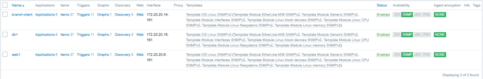
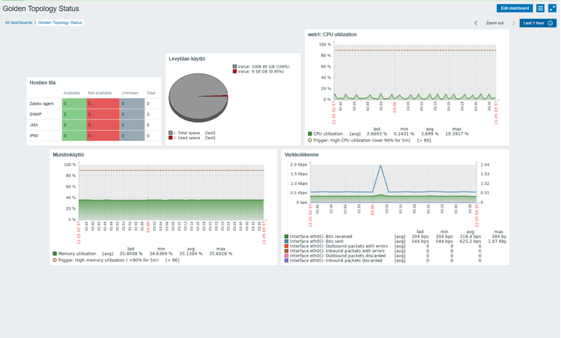
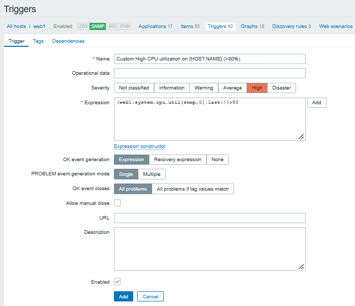
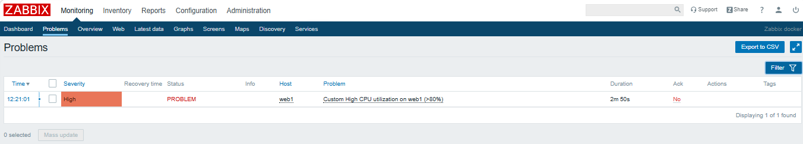
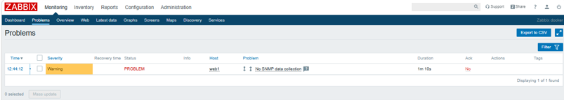

# Viikko 6 – Zabbix ja keskitetty verkonvalvonta

## 1. Johdanto
Zabbix on avoimen lähdekoodin keskitetty verkon- ja palvelinten valvontajärjestelmä. Sen avulla kerätään reaaliaikaista tietoa IT-infrastruktuurin tilasta, suorituskyvystä ja saatavuudesta, visualisoidaan dataa dashboardeille ja lähetetään automaattisia hälytyksiä vikatilanteista. Tällä viikolla yhdistin aiemmilla viikoilla rakennetun verkkoympäristön (SNMP, virtuaaliset Linux-palvelimet) keskitettyyn Zabbix-valvontaan.

### Zabbixin käyttöliittymän osat (Tehtävä 6.1)
* **Hosts:** Hallintanäkymä, jossa määritellään valvottavat laitteet, niiden IP-osoitteet, liitetyt templatet ja host-ryhmät.
* **Templates:** Valmiit valvontamallit, jotka sisältävät valmiiksi määritellyt mittarit (Items), hälytysehdot (Triggers) ja kuvaajat tietyntyyppisille laitteille tai käyttöjärjestelmille.
* **Monitoring:** Reaaliaikainen näkymä verkon tilaan; sisältää mm. aktiiviset hälytykset (Problems), hostien tilat sekä kerätyn raakadatan (Latest data).
* **Dashboards:** Muokattavat koontinäkymät, joihin kootaan tärkeimmät graafit ja tilatiedot visuaaliseen muotoon.
* **Alerts:** Hälytysten ohjaus ja toimintatavat (Actions, Media types), eli miten ja kenelle hälytykset toimitetaan.
* **Reports:** Järjestelmän tilan, saatavuuden (SLA) ja yleisimpien hälytysten yhteenvetoraportit.

---

## 2. Hostien lisääminen
Valvontaan lisättiin kolme ympäristön Linux-laitetta käyttäen SNMPv2-valvontaa ja valmista `Template OS Linux SNMPv2` -mallia:
1. **web1** – IP: `172.20.20.6`, Ryhmä: `Linux servers`
2. **db1** – IP: `172.20.20.15`, Ryhmä: `Linux servers`
3. **branch-client** – IP: `172.20.20.14`, Ryhmä: `Linux servers`

Kaikki kolme laitetta yhdistyivät onnistuneesti (vihreä `SNMP`-tilakuvake) ja alkoivat lähettää mittausdataa Zabbix-palvelimelle.



---

## 3. Dashboard
Loin dashboardin nimeltä **Golden Topology Status**, joka kokoaa yhteen näkymään kaikkien hostien saatavuuden sekä kriittisimmät resurssimittarit (CPU-kuorma, muistinkäyttö, levytilan käyttö ja verkkoliikenne). Dashboard tarjoaa yhdellä silmäyksellä selkeän kokonaiskuvan ympäristön tilasta.



---

## 4. Mittarit
Seuraavassa taulukossa on analysoitu kuusi keskeistä valvontamittaria (`web1`-palvelimelta `Monitoring -> Latest data` -näkymästä):

| Mittari | Arvo (`web1`) | Mitä mittari kertoo ja miksi sitä kannattaa seurata |
| :--- | :--- | :--- |
| **CPU utilization** | `0.90 %` | **Mitä kertoo:** Prosessorin kokonaiskuormituksen prosentteina (alle 1 % osoittaa lepotilaa).<br>**Miksi seurataan:** Auttaa havaitsemaan ylikuormituksen, jumiutuneet prosessit tai palvelunestohyökkäykset ennen kuin palvelu hidastuu käyttäjille. |
| **Memory utilization** | `35.39 %` | **Mitä kertoo:** Käytössä olevan keskusmuistin prosentuaalisen osuuden.<br>**Miksi seurataan:** Jatkuvasti kasvava muistinkäyttö paljastaa sovellusten muistivuodot ja ehkäisee muistin loppumisesta johtuvat kaatumiset. |
| **Available memory** | `5.01 GB` | **Mitä kertoo:** Uusille prosesseille ja välimuistille vapaana olevan keskusmuistin määrän.<br>**Miksi seurataan:** Varmistaa, että palvelimella on riittävästi puskuria äkillisiä kuormituspiikkejä (esim. kävijäpiikkejä tai tietokantakyselyitä) varten. |
| **System uptime** | `01:07:33` | **Mitä kertoo:** Ajan, jonka järjestelmä on ollut yhtäjaksoisesti käynnissä ilman uudelleenkäynnistystä.<br>**Miksi seurataan:** Äkillinen nollaantuminen paljastaa huomaamatta tapahtuneen kaatumisen, sähkökatkon tai luvattoman uudelleenkäynnistyksen. |
| **Interface eth0: Bits received / sent** | `320 bps` (in) / `528 bps` (out) | **Mitä kertoo:** Verkkoliikenteen siirtonopeuden palvelimen verkkoliitännän läpi sisään ja ulos.<br>**Miksi seurataan:** Auttaa tunnistamaan verkon pullonkaulat, epätavalliset liikennepiikit (kuten tietovuodot) sekä yhteyskatkokset. |
| **/: Space utilization** | `0.95 %` | **Mitä kertoo:** Juuritiedostojärjestelmän (`/`) käytetyn levytilan osuuden prosentteina.<br>**Miksi seurataan:** Täyttyvä levy estää lokien kirjoittamisen ja pysäyttää tietokantojen ja web-palveluiden toiminnan kokonaan. |

---

## 5. Triggerit
Loin `web1`-hostille kaksi omaa triggeriä poikkeustilanteiden tunnistamiseen:

1. **Custom High CPU utilization on {HOST.NAME} (>80%)**
   * **Ehto:** `{web1:system.cpu.util[snmp,0].last()}>80`
   * **Vakavuusluokka:** High
   * **Toiminta:** Laukaisee korkean tason hälytyksen, kun prosessorin kuormitus ylittää 80 %.
2. **Custom Low free disk space on {HOST.NAME} (<20%)**
   * **Ehto:** `{web1:vfs.fs.pused[storageUsedPercentage.31].last()}>80`
   * **Vakavuusluokka:** Warning
   * **Toiminta:** Laukaisee varoituksen, kun käytetty levytila ylittää 80 % (eli vapaa levytila laskee alle 20 prosentin).



---

## 6. Hälytys- ja häiriötestit

### Testi 1: CPU-kuormitus (Tehtävä 6.8)
* **Toimenpide:** Ajoin `web1`-palvelimella taustaprosesseina `yes > /dev/null` -komennon kaikille prosessoriytimille.
* **Havainnot:** Itse luotu `Custom High CPU utilization on web1 (>80%)` -triggeri laukesi nopeasti ja ilmestyi *Problems*-näkymään punaisena *High*-hälytyksenä (klo 12:21:01). Noin neljä minuuttia myöhemmin myös templaten valmis *Warning*-tason triggeri (`> 90 % for 5m`) laukesi kaikilla kolmella hostilla, koska kontit jakavat saman isäntäkoneen prosessoriresurssit. Kun sammutin kuormitusprosessit (`pkill yes`), kaikki hälytykset kuittaantuivat automaattisesti tilaan **RESOLVED** (klo 12:38:01).



### Testi 2: Häiriötilanne ja palvelun pysäytys (Tehtävä 6.9)
* **Toimenpide:** Pysäytin `web1`-palvelimen SNMP-palvelun komennolla `service snmpd stop`.
* **Havainnot:** Zabbix havaitsi yhteyskatkoksen muutaman minuutin kuluessa, jolloin *Problems*-näkymään ilmestyi keltainen *Warning*-tason hälytys `No SNMP data collection` (klo 12:44:12) ja `web1`-laitteen `SNMP`-tilakuvake muuttui punaiseksi. Kun käynnistin palvelun uudelleen (`service snmpd start`), yhteys palautui normaaliksi ja hälytys kuittaantui.



---

## 7. Kurssin työkalujen vertailu (Tehtävä 6.10)

| Ominaisuus | SNMP | Prometheus | Zabbix |
| :--- | :--- | :--- | :--- |
| **Tiedonkeruu** | Poll-pohjainen (manageri kyselee) + Trap-viestit laitteilta. | Pull-pohjainen (hakee HTTP-rajapinnasta `/metrics`). | Monipuolinen: oma Agent (push/pull), SNMP, ICMP, IPMI, HTTP. |
| **Dashboardit** | Ei sisäänrakennettua, vaatii erillisen hallintaohjelman. | Perusnäkymä graafeille; vaatii yleensä Grafanan rinnalle. | Sisäänrakennetut, monipuoliset dashboardit ja verkkokartat. |
| **Hälytykset** | Rajoittuu laitteiden lähettämiin Trap-viesteihin. | Erillinen Alertmanager-komponentti hoitaa hälytykset. | Sisäänrakennettu trigger- ja hälytysmoottori suoraan paketissa. |
| **Käyttöönotto** | Kevyt verkkolaitteissa, mutta OID-tietojen hallinta työlästä. | Kevyt käynnistää (kontit), vaatii exportereiden asennuksen. | Vaatii tietokantapalvelimen, mutta valmiit templatet nopeuttavat käyttöönottoa. |
| **Skaalautuvuus** | Hyvä perusverkoissa, mutta raskaat kyselyt voivat kuormittaa. | Erinomainen pilvi- ja konttiympäristöissä (dynaaminen). | Skaalautuu suuriin yritysverkkoihin Zabbix Proxyjen avulla. |
| **Yrityskäyttö** | Standardi verkkolaitteiden (kytkimet, reitittimet) valvonnassa. | Yleinen moderneissa DevOps-, Kubernetes- ja pilviympäristöissä. | Erittäin suosittu kokonaisvaltaisessa palvelin- ja verkkoinfran valvonnassa. |

---

## 8. Pohdinta ja yhteenveto (Tehtävä 6.11)

* **Mitä hyötyä keskitetystä valvonnasta on?**
  Keskitetty valvonta kokoaa kaikkien palvelinten, verkkolaitteiden ja palveluiden tilatiedot yhteen paikkaan. Sen ansiosta ylläpitäjä näkee kokonaiskuvan yhdellä silmäyksellä, paikantaa vikatilanteiden juurisyyt nopeasti ja pystyy reagoimaan ongelmiin ennakoivasti ennen kuin ne aiheuttavat käyttökatkoja loppukäyttäjille.
* **Mitkä mittarit ovat mielestäsi tärkeimpiä?**
  Tärkeimpiä ovat laitteiden ja palveluiden saatavuus (ping, SNMP/agentin tila, HTTP-vastaukset), prosessorin kuormitus (CPU), keskusmuistin käyttö, vapaan levytilan määrä sekä verkkoliikenteen nopeus ja pakettihävikki.
* **Millaisista tilanteista ylläpitäjän pitäisi saada hälytys?**
  Hälytys tulee lähettää tilanteista, jotka uhkaavat palvelun toimintaa tai vaativat välitöntä toimenpidettä – esimerkiksi kun kriittinen palvelu tai laite ei vastaa, levytila on loppumassa tai resurssikuorma pysyy poikkeuksellisen korkeana. Turhia ja liian herkkiä hälytyksiä (ns. *alert fatigue*) tulee välttää sopivilla viiveillä ja kynnysarvoilla.
* **Missä tilanteissa käyttäisit Prometheusta?**
  Käyttäisin Prometheusta moderneissa, dynaamisissa kontti-, Kubernetes- ja mikropalveluympäristöissä, joissa palveluita käynnistetään ja sammutetaan automaattisesti ja joissa aikasarjadataa halutaan visualisoida tarkasti Grafanan avulla.
* **Missä tilanteissa käyttäisit Zabbixia?**
  Käyttäisin Zabbixia perinteisemmissä yritysverkoissa ja hybridi-infrastruktuureissa, joissa valvotaan samanaikaisesti fyysisiä ja virtuaalisia palvelimia, reitittimiä, kytkimiä ja palomuureja yhdellä valmiilla kokonaisratkaisulla.
* **Mitä valvontatoimintoja lisäisit tähän ympäristöön?**
  Lisäisin ympäristöön verkon reitittimien (`r1`, `r2`, `r3`) SNMP-valvonnan, automaattisen verkon laitteiden etsinnän (*Network Discovery*), web-skenaariot (`web1`-palvelimen HTTP 200 OK -tarkistuksen) sekä hälytysten ohjauksen suoraan sähköpostiin tai tiimin viestintäkanavaan (esim. Slack tai Teams).

---

### Palautuksen kansiorakenne
Raportti ja siihen liittyvät kuvakaappaukset on tallennettu repositorioon seuraavan rakenteen mukaisesti:

```text
reports/
├── week06.md
└── images/
    ├── dashboard.png
    ├── hosts.png
    ├── trigger-cpu.png
    ├── alert-test.png
    └── snmp-down.png
```§